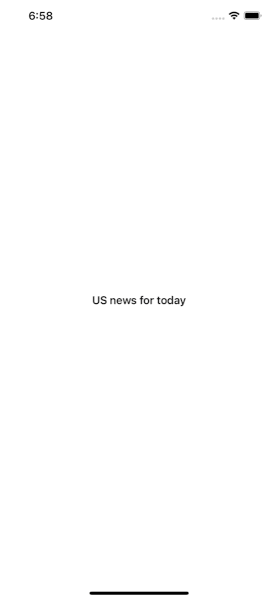

# SwiftUI with MVVM

Simple SwiftUI App demonstrates lists of US news (thanks https://newsapi.org/).
UPDT: Add WidgetKit and deeplinks. Add WatchOS support.




### Usage:
* `SwiftUI`
* `WidgetKit`
* `WatchOS`
* `MVVM pattern`
* `Network services`


### Requirements:
* Xcode 26+ (Swift 6.2, strict concurrency, MainActor by default)
* iOS 18+ (app and widget), watchOS 11+ (standalone SwiftUI watch app)

### Setup: your own NewsAPI key
The app needs a [newsapi.org](https://newsapi.org) API key. **Please use your own key** — it is free:

1. Register at https://newsapi.org/register and copy your API key.
2. Create a local secrets file from the template (the copy is git-ignored, so your key never gets committed):
   ```bash
   cp Config/Secrets.example.xcconfig Config/Secrets.xcconfig
   ```
3. Open `Config/Secrets.xcconfig` and paste the key after `=` (no quotes):
   ```
   NEWS_API_KEY = 0123456789abcdef0123456789abcdef
   ```
4. Open `NewsFeed.xcodeproj` (Xcode 26+) and run the `NewsFeed` scheme. If the key is empty the console shows `NewsAPI key is missing` and the list stays empty.

How it works: `Secrets.xcconfig` → build setting `NEWS_API_KEY` → Info.plist `NewsAPIKey` (app, widget and watch extension) → `NewsAPIConfiguration`, which sends it in the `X-Api-Key` header.

### Project structure:
* `Packages/NewsKit` — local Swift package shared by every target: `Article` model, `LiveNewsAPIClient` (async/await, typed `NewsAPIError`), `NewsRepository` (in-memory cache, request coalescing, de-duplication), date formatting, `ImageLoader` and the widget's `HeadlineSchedule`.
* `NewsFeed` — iOS app (SwiftUI, MVVM with `@Observable`): `App/`, `Features/NewsList`, `Features/ArticleDetail`; `Shared/` (view model, error texts, sample data) is also compiled into the watch app.
* `NewsWidget` — WidgetKit extension. Tapping a headline opens `newsfeed://article?url=<article URL>` (see `DeepLink` in NewsKit).
* `NewsFeedWatch` — standalone SwiftUI watchOS app.
* `NewsFeedTests` — app tests; `Packages/NewsKit/Tests` — package tests (Swift Testing).

### Tests:
All tests (app + NewsKit) via the `NewsFeed` scheme and its test plan:
```bash
xcodebuild test -project NewsFeed.xcodeproj -scheme NewsFeed -destination 'platform=iOS Simulator,name=iPhone 17'
```
NewsKit only, on macOS in about a second:
```bash
swift test --package-path Packages/NewsKit
```
